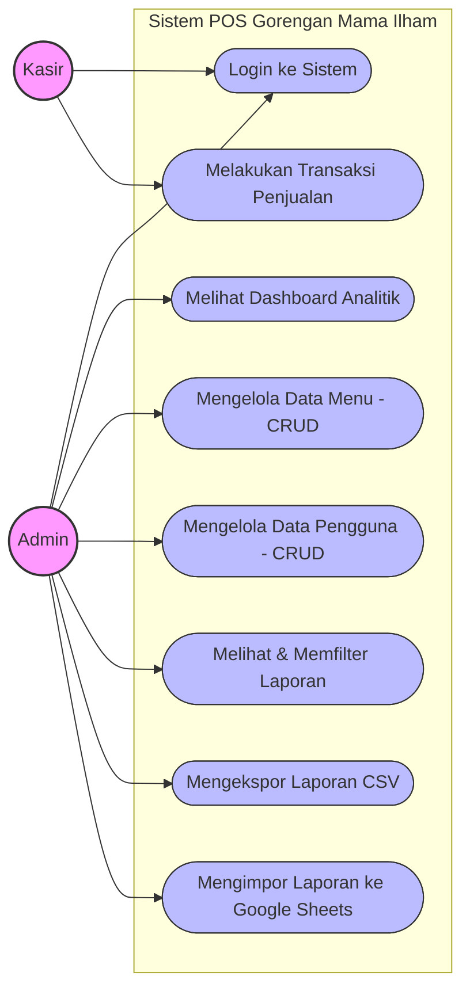
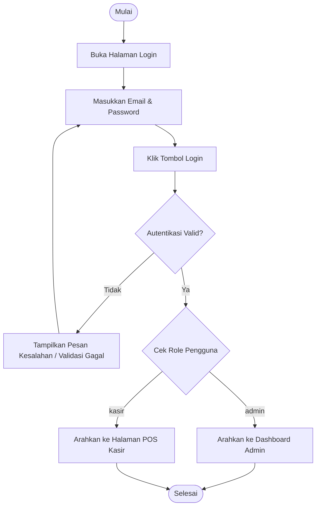
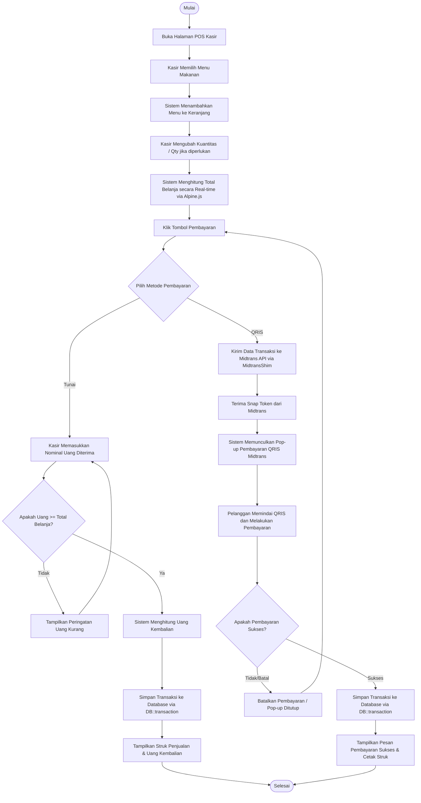
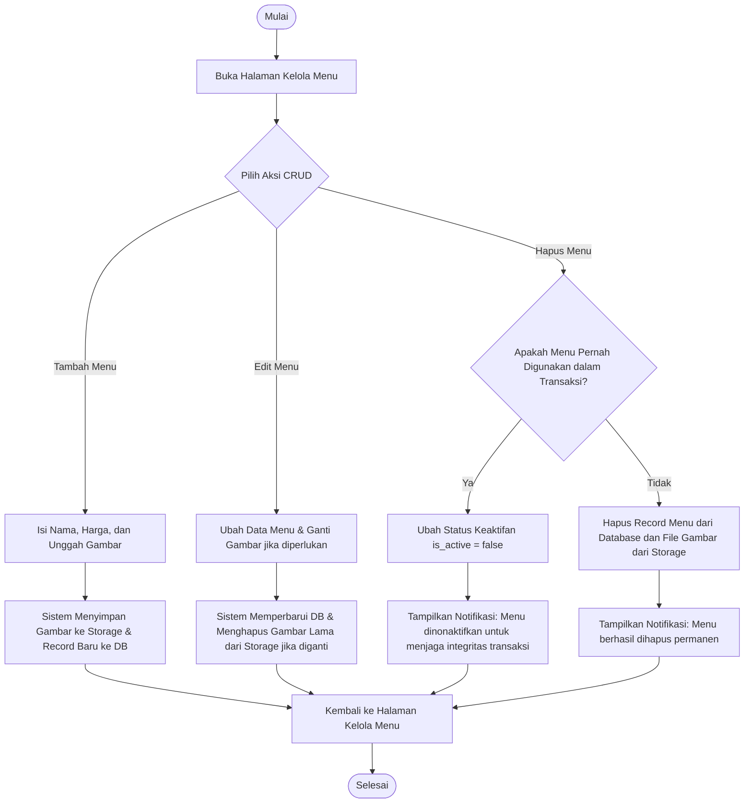
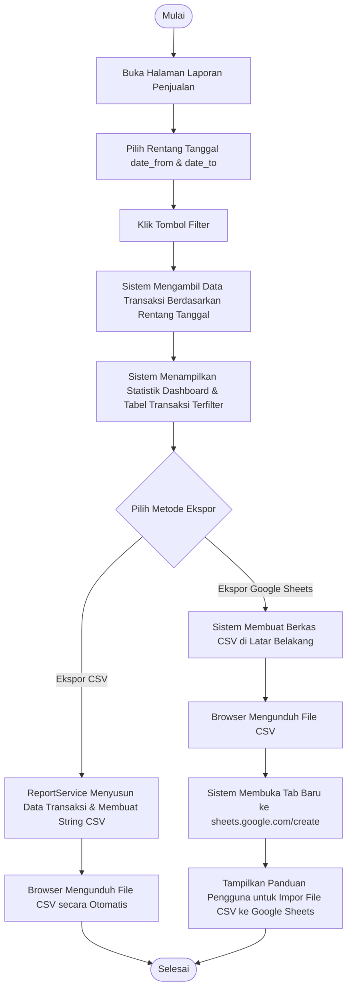
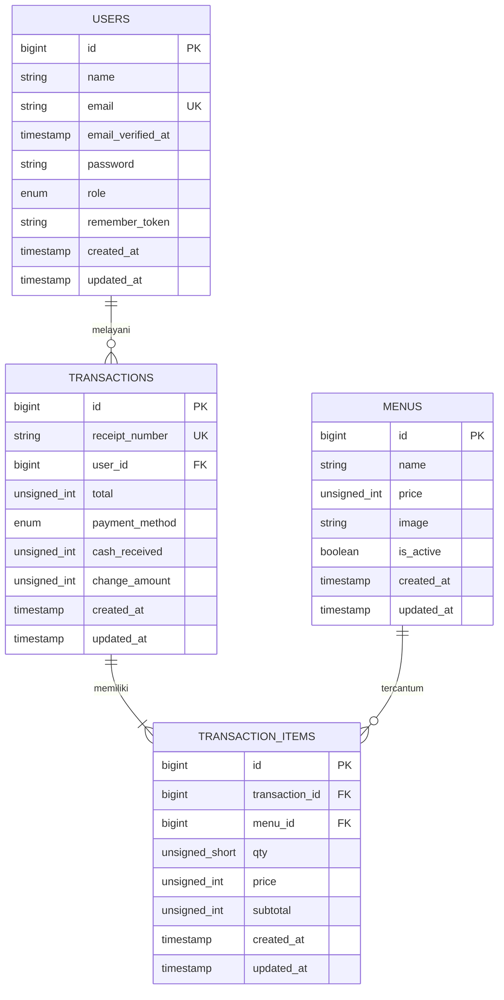

# DOKUMENTASI SISTEM POS (KASIR) GORENGAN MAMA ILHAM
## (Bahan Penulisan Draf Skripsi - Bab Analisis & Perancangan Sistem)

Dokumen ini berisi diagram perancangan sistem (*Unified Modeling Language* / UML) dan rancangan basis data (*Entity Relationship Diagram* / ERD) beserta kamus data lengkap untuk sistem **Gorengan Mama Ilham**. Anda dapat menyalin teks dan diagram di bawah ini langsung ke dalam draf skripsi Anda.

---

## 1. Use Case Diagram
*Use Case Diagram* menggambarkan fungsionalitas sistem yang disediakan bagi aktor (pengguna) dan interaksi mereka dengan sistem POS Gorengan Mama Ilham.

### A. Diagram Use Case (Mermaid.js)

### B. Deskripsi Aktor (Actor Description)
| No | Aktor | Deskripsi |
|---|---|---|
| 1 | **Kasir** | Staf operasional toko yang bertugas melayani transaksi pembelian dari pelanggan di kasir, mencatat item belanjaan, dan menerima pembayaran (Tunai / QRIS). |
| 2 | **Admin** | Pengelola utama sistem yang memiliki hak akses penuh terhadap manajemen data menu makanan, pengelolaan akun pengguna (Kasir/Admin), serta memantau laporan keuangan penjualan dan analitik performa toko. |

### C. Deskripsi Use Case (Use Case Description)
1. **Login ke Sistem**: Proses autentikasi pengguna masuk ke dalam aplikasi menggunakan pasangan surel (*email*) dan kata sandi (*password*) yang terdaftar.
2. **Melihat Dashboard Analitik**: Menampilkan ringkasan total pendapatan, total transaksi, rata-rata transaksi, menu terlaris, dan visualisasi grafik penjualan menu terpopuler bagi Admin.
3. **Mengelola Data Menu (CRUD)**: Mengizinkan Admin untuk melakukan proses pembuatan (Create), pembacaan (Read), pembaruan (Update), dan penonaktifan (Delete/Disable) pada data menu gorengan.
4. **Mengelola Data Pengguna (CRUD)**: Mengizinkan Admin untuk menambahkan, mengedit, mengubah kata sandi, dan menghapus akun Kasir atau Admin lain.
5. **Melakukan Transaksi Penjualan**: Alur utama kasir untuk memilih menu, mengubah jumlah kuantitas, memilih metode pembayaran (Tunai/QRIS), memproses transaksi keuangan, dan mencetak struk fisik/digital.
6. **Melihat & Memfilter Laporan**: Memungkinkan Admin untuk memantau detail riwayat transaksi penjualan yang dapat difilter berdasarkan rentang tanggal tertentu.
7. **Mengekspor Laporan CSV**: Mengizinkan Admin untuk mengunduh laporan penjualan yang terfilter ke dalam format berkas comma-separated values (CSV).
8. **Mengimpor Laporan ke Google Sheets**: Alur otomatis di mana sistem memicu pengunduhan CSV lalu membuka tab baru menuju pembuatan dokumen Google Sheets serta membimbing pengguna mengimpor CSV secara cepat.

---

## 2. Activity Diagram
*Activity Diagram* menggambarkan alur kerja (workflow) atau aktivitas dari proses bisnis utama yang berjalan di dalam sistem.

### A. Activity Diagram: Login & Autentikasi Pengguna
Menjelaskan alur pengguna (Admin/Kasir) saat melakukan login ke sistem dan pengalihan halaman berdasarkan hak akses (Role).

### B. Activity Diagram: Transaksi Penjualan (POS)
Menggambarkan alur kasir saat mencatat pesanan pelanggan hingga pembayaran selesai baik melalui Tunai maupun QRIS Midtrans.

### C. Activity Diagram: Manajemen Data Menu (CRUD & Soft Restriction)
Menggambarkan alur Admin saat mengelola menu, khususnya logika penanganan penghapusan menu yang telah memiliki riwayat transaksi (Soft Restriction).

### D. Activity Diagram: Ekspor Laporan Penjualan (CSV & Google Sheets)
Menggambarkan alur Admin ketika menyusun laporan penjualan berdasarkan filter tanggal dan mengekspornya.

---

## 3. Entity Relationship Diagram (ERD)
*Entity Relationship Diagram* (ERD) menyajikan hubungan logis antara tabel-tabel penyusun database dalam sistem POS Gorengan Mama Ilham.

### A. Skema Relasi Database (Mermaid.js)

### B. Hubungan Relasi Logis
1. **Hubungan `USERS` ke `TRANSACTIONS` (One-to-Many / $1 : N$)**:
   - Satu Pengguna (dengan role Kasir atau Admin) dapat melayani atau mencatat **banyak** (`0..N`) Transaksi Penjualan.
   - Setiap Transaksi Penjualan dicatat dan dilayani oleh **tepat satu** (`1`) Pengguna (`user_id`).
2. **Hubungan `TRANSACTIONS` ke `TRANSACTION_ITEMS` (One-to-Many / $1 : N$)**:
   - Setiap Transaksi memiliki **satu atau banyak** (`1..N`) detail item pembelian (`transaction_items`).
   - Setiap item pembelian (`transaction_items`) terikat pada **tepat satu** (`1`) Transaksi induk (`transaction_id`).
3. **Hubungan `MENUS` ke `TRANSACTION_ITEMS` (One-to-Many / $1 : N$)**:
   - Satu Menu gorengan dapat tercantum atau dibeli dalam **banyak** (`0..N`) detail item transaksi.
   - Setiap detail item transaksi (`transaction_items`) hanya merujuk pada **tepat satu** (`1`) Menu gorengan (`menu_id`).

---

## 4. Kamus Data (Data Dictionary)
Berikut adalah rincian struktur dan properti dari setiap tabel dalam database sistem POS Gorengan Mama Ilham.

### A. Tabel `users` (Manajemen Pengguna)
*   **Fungsi**: Menyimpan data identitas kredensial pengguna yang dapat mengakses sistem (Admin dan Kasir).
*   **Kunci Utama (Primary Key)**: `id`

| Nama Kolom | Tipe Data | Nullable | Default | Keterangan |
|---|---|---|---|---|
| **id** | BigInt (Unsigned) | No | *Auto-Increment* | Kunci Utama (*Primary Key*) tabel. |
| **name** | Varchar(255) | No | - | Nama lengkap pengguna. |
| **email** | Varchar(255) | No | - | Alamat surel unik untuk kredensial login (*Unique Key*). |
| **email_verified_at** | Timestamp | Yes | NULL | Waktu verifikasi email (opsional). |
| **password** | Varchar(255) | No | - | Kata sandi pengguna yang dienkripsi (Bcrypt hash). |
| **role** | Enum('admin', 'kasir') | No | 'kasir' | Tingkat hak akses pengguna di dalam sistem. |
| **remember_token** | Varchar(100) | Yes | NULL | Token sesi untuk fitur "remember me" Laravel. |
| **created_at** | Timestamp | Yes | NULL | Tanggal & waktu record data pertama kali dibuat. |
| **updated_at** | Timestamp | Yes | NULL | Tanggal & waktu record data terakhir kali diubah. |

### B. Tabel `menus` (Daftar Menu Gorengan)
*   **Fungsi**: Menyimpan informasi menu makanan/gorengan yang ditawarkan kepada pelanggan.
*   **Kunci Utama (Primary Key)**: `id`

| Nama Kolom | Tipe Data | Nullable | Default | Keterangan |
|---|---|---|---|---|
| **id** | BigInt (Unsigned) | No | *Auto-Increment* | Kunci Utama (*Primary Key*) tabel. |
| **name** | Varchar(255) | No | - | Nama menu gorengan (misal: Bakwan, Mendoan, Tahu). |
| **price** | Integer (Unsigned) | No | - | Harga satuan menu gorengan dalam rupiah. |
| **image** | Varchar(255) | Yes | NULL | Path letak penyimpanan berkas foto menu gorengan. |
| **is_active** | TinyInt(1) / Boolean | No | 1 (true) | Indikator menu aktif. Jika `false` (0), menu tidak muncul di POS. |
| **created_at** | Timestamp | Yes | NULL | Tanggal & waktu record menu ditambahkan. |
| **updated_at** | Timestamp | Yes | NULL | Tanggal & waktu record menu diperbarui. |

### C. Tabel `transactions` (Header Transaksi)
*   **Fungsi**: Menyimpan informasi transaksi utama (informasi umum nota penjualan).
*   **Kunci Utama (Primary Key)**: `id`
*   **Kunci Asing (Foreign Key)**: `user_id` merujuk ke `users.id`

| Nama Kolom | Tipe Data | Nullable | Default | Keterangan |
|---|---|---|---|---|
| **id** | BigInt (Unsigned) | No | *Auto-Increment* | Kunci Utama (*Primary Key*) tabel. |
| **receipt_number** | Varchar(255) | No | - | Nomor unik struk transaksi (format: `#0001`, `#0002`, dst). |
| **user_id** | BigInt (Unsigned) | No | - | Kunci Asing (*Foreign Key*) merujuk ke staf kasir yang melayani. |
| **total** | Integer (Unsigned) | No | - | Akumulasi total belanja pelanggan dalam Rupiah. |
| **payment_method** | Enum('tunai', 'qris') | No | - | Metode pembayaran yang dipilih. |
| **cash_received** | Integer (Unsigned) | Yes | NULL | Nominal uang tunai yang diterima (hanya jika metode = 'tunai'). |
| **change_amount** | Integer (Unsigned) | Yes | NULL | Jumlah uang kembalian (hanya jika metode = 'tunai'). |
| **created_at** | Timestamp | Yes | NULL | Tanggal & waktu transaksi sukses tercatat. |
| **updated_at** | Timestamp | Yes | NULL | Tanggal & waktu data transaksi diperbarui. |

### D. Tabel `transaction_items` (Rincian Item Transaksi)
*   **Fungsi**: Menyimpan rincian item barang yang dibeli per transaksi (menghubungkan transaksi dengan menu).
*   **Kunci Utama (Primary Key)**: `id`
*   **Kunci Asing (Foreign Key)**: 
    *   `transaction_id` merujuk ke `transactions.id`
    *   `menu_id` merujuk ke `menus.id`

| Nama Kolom | Tipe Data | Nullable | Default | Keterangan |
|---|---|---|---|---|
| **id** | BigInt (Unsigned) | No | *Auto-Increment* | Kunci Utama (*Primary Key*) tabel. |
| **transaction_id** | BigInt (Unsigned) | No | - | Kunci Asing (*Foreign Key*) merujuk ke transaksi induknya. |
| **menu_id** | BigInt (Unsigned) | No | - | Kunci Asing (*Foreign Key*) merujuk ke menu gorengan yang dibeli. |
| **qty** | SmallInt (Unsigned) | No | - | Jumlah kuantitas porsi item menu yang dibeli. |
| **price** | Integer (Unsigned) | No | - | Harga jual menu per unit saat transaksi berlangsung (mencegah distorsi data jika ada kenaikan harga menu di masa depan). |
| **subtotal** | Integer (Unsigned) | No | - | Hasil perkalian kuantitas dengan harga (`qty * price`). |
| **created_at** | Timestamp | Yes | NULL | Tanggal & waktu item transaksi dicatat. |
| **updated_at** | Timestamp | Yes | NULL | Tanggal & waktu record item transaksi diperbarui. |

---

## 5. Penerapan Integritas Data Fisik (Constraints)
1. **Foreign Key `user_id` pada `transactions`**:
   - `FOREIGN KEY (user_id) REFERENCES users(id) ON DELETE CASCADE`
   - Menghubungkan transaksi dengan pembuatnya. Jika pengguna dihapus, maka secara berantai (*cascade*) transaksi yang dilayaninya akan ikut terhapus (atau dapat diubah ke opsi *restrict* tergantung kebijakan, tetapi secara *default migration* Laravel adalah `cascadeOnDelete`).
2. **Foreign Key `transaction_id` pada `transaction_items`**:
   - `FOREIGN KEY (transaction_id) REFERENCES transactions(id) ON DELETE CASCADE`
   - Integrasi erat antara header dan detail. Jika transaksi dihapus, semua baris rincian di tabel `transaction_items` akan terhapus secara otomatis untuk mencegah adanya sampah data (*orphan record*).
3. **Foreign Key `menu_id` pada `transaction_items`**:
   - `FOREIGN KEY (menu_id) REFERENCES menus(id) ON DELETE CASCADE`
   - Menjamin bahwa menu yang dimasukkan ke detail transaksi memang valid terdaftar. Untuk menjaga data transaksi masa lalu agar tidak hilang/rusak saat menu tidak dijual lagi, sistem menerapkan aturan *soft restriction* di tingkat aplikasi: menu tidak dihapus secara fisik (`DELETE`), melainkan statusnya diubah menjadi tidak aktif (`is_active = false`).
